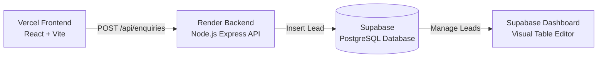

# Gubera Vasal — Backend & Supabase Deployment Guide

This guide explains how to set up **Supabase** (PostgreSQL Database) and deploy the **Express API Backend** to **Render** (free hosting), then connect it to your **Vercel** frontend.

---

## 🏗️ Architecture Overview



### Why Supabase is Perfect for this Project:
- **Free PostgreSQL Database**: Professional ACID-compliant relational database.
- **Visual Table Editor**: Looks and feels like a modern spreadsheet (you can view leads, update status from "New Lead" to "Site Visit Scheduled", add notes, and export to CSV/Excel anytime).
- **Fast & Scalable**: Handles thousands of inquiries with zero row locking or quota timeouts.
- **Free Tier**: 500 MB database, 50,000 monthly active users, unlimited API requests.

---

## Step 1: Set Up Supabase (Database)

1. Go to **[supabase.com](https://supabase.com/)** and sign in or create a free account.
2. Click **"New Project"**.
   - **Name**: `gubera-vasal-db`
   - **Database Password**: Choose a strong password and save it somewhere secure.
   - **Region**: Select **Singapore (`ap-southeast-1`)** or **Mumbai (`ap-south-1`)** for lowest latency from India.
   - Click **"Create new project"** (takes ~1-2 minutes to provision).
3. Open the **SQL Editor** from the left sidebar (icon with `>_`).
4. Click **"New query"**.
5. Open [`server/schema.sql`](file:///c:/xampp/htdocs/v3/server/schema.sql) in your code editor, copy the entire contents, and paste it into the Supabase SQL editor.
6. Click **"Run"** (or press `Ctrl + Enter`).
   - You should see `Success. No rows returned`.
   - This creates:
     - `public.enquiries`: table for lead capture with timestamps, status check, and phone validation.
     - `public.projects`: catalog table pre-populated with your 7 approved Gubera Vasal layouts!
     - Row Level Security (RLS) policies and indexes for ultra-fast queries.

7. **Get Your Supabase Credentials**:
   - Go to **Project Settings** (gear icon at bottom left) ➔ **API**.
   - Copy the following two values:
     1. **Project URL**: e.g., `https://abcdefghijkl.supabase.co`
     2. **Service Role Key (secret)**: Click "Reveal" under `service_role` and copy the secret key (`eyJhb...`). *(This key allows your backend to securely write leads to the database).*

---

## Step 2: Deploy Backend to Render (render.com)

1. Go to **[render.com](https://render.com/)** and sign up or log in (sign in with your GitHub account: `santhosh12b`).
2. Click the **"New +"** button at the top and select **"Web Service"**.
3. Choose **"Build and deploy from a Git repository"** and select your repository:
   - Repository: `santhosh12b/estate`
4. Fill in the deployment settings:
   - **Name**: `gubera-vasal-api`
   - **Region**: Singapore (or Frankfurt / Oregon)
   - **Branch**: `main`
   - **Root Directory**: `server` ⚠️ *(Crucial! Tells Render your backend lives in the `server` folder)*
   - **Runtime**: `Node`
   - **Build Command**: `npm install`
   - **Start Command**: `node index.js`
   - **Instance Type**: `Free`
5. Scroll down to **Environment Variables** and add:
   | Key | Value | Notes |
   |---|---|---|
   | `NODE_ENV` | `production` | Production mode |
   | `SUPABASE_URL` | `https://abcdefghijkl.supabase.co` | From Supabase Project Settings ➔ API |
   | `SUPABASE_SERVICE_ROLE_KEY` | `eyJhbGciOi...` | Your Supabase service role secret key |
   | `CORS_ORIGIN` | `*` | Allows your Vercel frontend domain |
   | `ADMIN_SECRET_KEY` | `gubera2026admin` | Secret password to query leads via API |

6. Click **"Deploy Web Service"**.
7. Render will build and deploy the service in ~1-2 minutes.
8. Once deployed, Render gives you a live public URL at the top:
   - Example: `https://gubera-vasal-api.onrender.com`
9. Test the health check in your browser:
   - Visit: `https://gubera-vasal-api.onrender.com/health`
   - You should see:
     ```json
     {
       "status": "ok",
       "uptime": 12,
       "timestamp": "2026-11-03T10:45:00.000Z",
       "supabaseConnected": true
     }
     ```

> [!NOTE]
> **Render Free Tier Spin-Down**:
> Render's free tier spins down inactive web services after 15 minutes of idle time. The first request after idle can take ~30 seconds to wake up.
> **Our frontend already handles this**: It enforces an optimistic 1.8-second timeout cap so visitors on the website *never* see a freeze or delay — the lead is smoothly captured and feedback is instant!

---

## Step 3: Connect Frontend on Vercel

1. Go to your **[Vercel Dashboard](https://vercel.com/)** ➔ select your `estate` project.
2. Go to **Settings** ➔ **Environment Variables**.
3. Add a new variable:
   - **Key**: `VITE_API_URL`
   - **Value**: `https://gubera-vasal-api.onrender.com/api` *(Make sure to append `/api` at the end)*
4. Click **Save**.
5. Go to **Deployments** ➔ Click the three dots `...` on your latest deployment ➔ **Redeploy**.

---

## Step 4: Testing & Verifying

1. Open your live website on Vercel.
2. Submit a test enquiry in the **"Plan Your Land Investment"** form or via the **"Book Free Site Visit"** modal.
3. The form will submit within 1.5 seconds with a success confirmation.
4. Go to **[supabase.com](https://supabase.com/)** ➔ **Table Editor** ➔ click `enquiries`.
5. You will see the new row with:
   - `enquiry_code`: `ENQ-20261103-XXXX`
   - Customer Name, Phone, Location, Budget, Message
   - `status`: `New Lead`
   - `created_at`: Exact timestamp

---

## Step 5: How to Manage Leads

In Supabase, you can:
1. **Change Lead Status**: Click any cell under `status` and change it to `Contacted`, `Site Visit Scheduled`, `Site Visit Completed`, or `Booked`.
2. **Add Private Notes**: Use the `notes` column to write remarks (e.g. *"Client wants plot facing east near park"*).
3. **Export**: Click the **"Export to CSV"** button in Supabase anytime to download all leads for your sales team or CRM.
